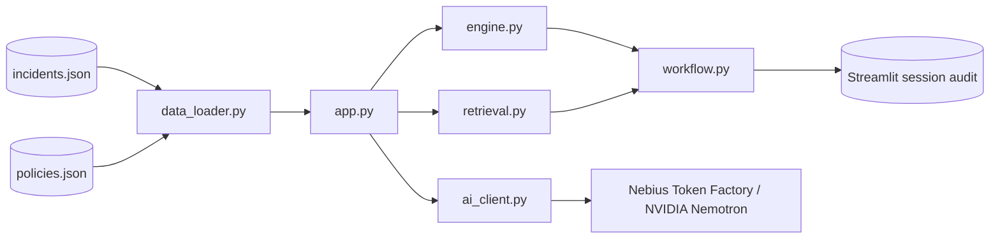

# Architecture

GuardBee separates deterministic security facts from optional generative explanation. The Streamlit layer coordinates presentation and session state; pure modules remain independently testable.

## Module responsibilities

- `app.py`: the GuardBee Security Analytics Console, a Streamlit UI with three `st.navigation` pages (Dashboard, Security Incidents, Audit History) and reusable component functions. It reads safe configuration, handles the fail-closed data-load error state, coordinates AI analysis (with an explicit retry after failure), gates simulated decisions through `workflow.py`, and shows the session audit. Styling comes from `.streamlit/config.toml` plus one static stylesheet injected with `st.html`; no data is ever interpolated into HTML. Data text appears in tables and metrics, as inline code (identifiers), or Markdown-escaped. Brand assets: `assets/guardbee_logo_full.svg` (full logo for the dashboard header: bee-shield image with vector "GuardBee" and "Security Analytics Console" text, so the words stay sharp), `assets/guardbee_logo.svg` (shield with light wordmark, sidebar logo for the dark sidebar), and `assets/guardbee_shield.png` (shield, browser-tab icon). The dashboard's overview donut uses Altair (a Streamlit dependency) and plots only engine output: classification counts when provided, otherwise severity counts. The UI never derives an activity class from score or severity. It displays `analysis["classification"]` (`SUSPICIOUS`, `INSUFFICIENT_EVIDENCE`, `NORMAL`, with the specification's wording), `analysis["investigation_priority"]`, and a `None` severity as "Not assigned" only when `engine.py` provides them, which it does not yet.
- `data_loader.py`: parses and validates JSON before it reaches the application.
- `engine.py`: creates explainable score, severity, flags, evidence IDs, and suggested action from selected events.
- `retrieval.py`: ranks policies with TF-IDF cosine similarity, returns at most `DEFAULT_TOP_K = 3` passages, and excludes scores below `DEFAULT_MIN_SIMILARITY = 0.08` by default. It never pads results with weaker matches. Ties keep corpus order. Invalid arguments or malformed policy entries raise `TypeError`/`ValueError`. Queries and corpora with no usable terms return no matches.
- `ai_client.py`: builds the guarded provider request and validates current event/policy IDs in a returned report, rejecting unknown, stale, and malformed (disguised) IDs.
- `workflow.py`: fingerprints current evidence/policy context and prevents duplicate/conflicting decisions for the same report.

## State model

Streamlit session state keeps `report`, `report_status`, `report_context_id`, `active_report_id`, `report_sequence`, `decision`, and `audit`, plus the UI keys `page`, `current_incident_id`, and `active_incident_id`. Changing an incident or requesting another analysis clears the active report/decision state. Historical audit entries remain only in the current session.

See [architecture diagram](diagrams/architecture.mmd) and [data flow diagram](diagrams/data_flow.mmd).
