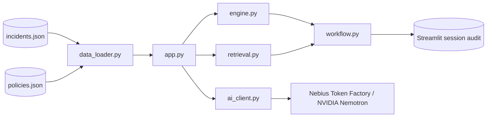

# Architecture

GuardBee separates deterministic security facts from optional generative explanation. The Streamlit layer coordinates presentation and session state; pure modules remain independently testable.

## Module responsibilities

- `app.py`: creates the dashboard, reads safe configuration, handles invalid-data UI state, coordinates analysis, and shows the session audit.
- `data_loader.py`: parses and validates JSON before it reaches the application.
- `engine.py`: creates explainable score, severity, flags, evidence IDs, and suggested action from selected events.
- `retrieval.py`: ranks policies with TF-IDF and excludes scores below `0.08` by default.
- `ai_client.py`: builds the guarded provider request and validates current event/policy IDs in a returned report.
- `workflow.py`: fingerprints current evidence/policy context and prevents duplicate/conflicting decisions for the same report.

## State model

Streamlit session state keeps `report`, `report_status`, `report_context_id`, `active_report_id`, `report_sequence`, `decision`, and `audit`. Changing an incident or requesting another analysis clears the active report/decision state. Historical audit entries remain only in the current session.

See [architecture diagram](diagrams/architecture.mmd) and [data flow diagram](diagrams/data_flow.mmd).
