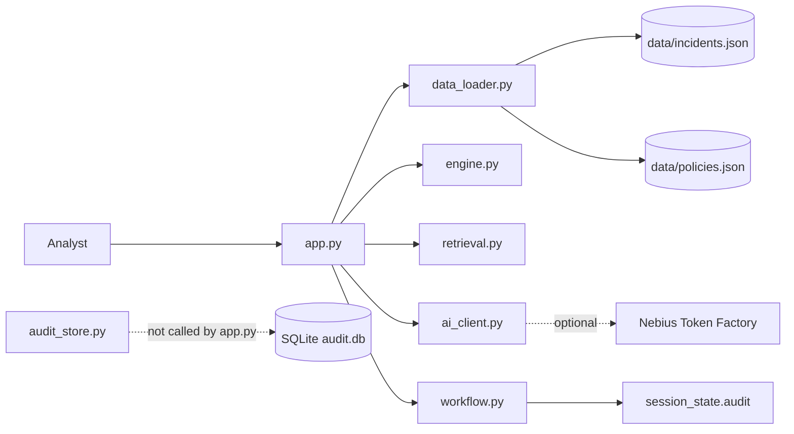

# GuardBee Architecture (MVP v2.2)

## System overview

GuardBee is a single-process Streamlit application. Deterministic analysis and retrieval run locally. AI reporting is an optional outbound call to Nebius Token Factory. Simulated decisions are gated in pure Python and stored in Streamlit session state by the UI.

## Module responsibilities

| Module | Responsibility | Used by `app.py` |
|---|---|---|
| `app.py` | Pages, session state, presentation, orchestration | — |
| `data_loader.py` | JSON read + validation | `load_incidents`, `load_policies` |
| `engine.py` | Rule-based analysis | `analyze_incident` |
| `retrieval.py` | TF-IDF policy match | `retrieve_policies`, `DEFAULT_MIN_SIMILARITY` |
| `ai_client.py` | Live report + citation checks | `generate_report`, `validate_report_citations`, `extract_citation_ids`, config helpers |
| `workflow.py` | Context hash + decision gate + record shape | `analysis_context_id`, `can_record_decision`, `build_decision_record` |
| `audit_store.py` | SQLite CRUD for decision records | **Not imported** |
| `ui_presentation.py` | Pure classification/filter helpers | **Not imported** (covered by tests; UI inlines similar helpers) |

Standalone APIs that exist but are unused by the current UI: `load_incidents_partitioned` / `partition_incidents`, and all of `audit_store.py`.

## Component interactions

Diagram source: [diagrams/architecture.mmd](diagrams/architecture.mmd)

## Application execution flow

1. `initialize_session` seeds report/decision/audit session keys.
2. `load_incidents` / `load_policies`; on `DataValidationError`, show error and `st.stop()`.
3. Build `analyses[id] = analyze_incident(incident)` for every loaded incident.
4. Navigation: Dashboard | Security Incidents | Audit History.
5. On investigation: build retrieval query from title, department, flags, suggested action; `retrieve_policies`.
6. `analysis_context_id(incident, analysis, matched_policies)` fingerprints the view.
7. AI request → `generate_report` → `validate_report_citations` against current event and matched policy IDs.
8. Decision buttons call `build_decision_record` via `can_record_decision`; success appends to `session_state.audit`.

Data-flow diagram: [diagrams/data_flow.mmd](diagrams/data_flow.mmd). Analyst workflow: [diagrams/workflow.mmd](diagrams/workflow.mmd).
