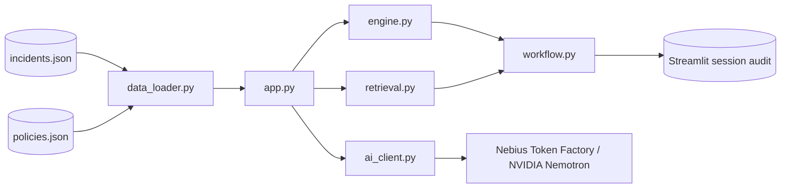

# Architecture

GuardBee separates deterministic security facts from optional generative explanation. The Streamlit layer coordinates presentation and session state; pure modules remain independently testable.

## Module responsibilities

- `app.py`: the GuardBee Security Analytics Console, a Streamlit UI with three `st.navigation` pages (Dashboard, Security Incidents, Audit History) and reusable component functions. It reads safe configuration, handles the fail-closed data-load error state, coordinates AI analysis (with an explicit retry after failure), gates simulated decisions through `workflow.py`, and shows the session audit. Styling comes from `.streamlit/config.toml` plus one static stylesheet injected with `st.html`; the only script is a fixed scroll-to-tabs snippet run once after a report request. No data is ever interpolated into HTML or script. Data text appears in tables and metrics, as inline code (identifiers), or Markdown-escaped. Brand assets: `assets/guardbee_logo.svg` (shield with light wordmark, sidebar logo for the dark sidebar), and `assets/guardbee_shield.png` (shield, browser-tab icon). The dashboard's overview donut uses Altair (a Streamlit dependency) and plots only engine output: classification counts when provided, otherwise severity counts. The UI never derives an activity class from score or severity. It displays `analysis["classification"]` (`SUSPICIOUS`, `INSUFFICIENT_EVIDENCE`, `NORMAL`, with the specification's wording), `analysis["investigation_priority"]`, and a `None` severity as "Not assigned" only when `engine.py` provides them (the v2.2 engine does); without them it shows "NOT CLASSIFIED" and a severity-based overview.
- `data_loader.py`: parses and validates JSON before it reaches the application.
- `engine.py` (v2.3 dynamic scoring, built on the v2.2 engine): sorts events chronologically and creates an explainable classification (`SUSPICIOUS`, `INSUFFICIENT_EVIDENCE`, `NORMAL`), risk score (0-100), severity (only for `SUSPICIOUS`, otherwise `None`), investigation priority (`HIGH`, `MEDIUM`, `LOW`, `NONE`), flags, evidence IDs, and suggested action. An incident is `SUSPICIOUS` when it has a failure burst (3+ failures inside the configurable 30-minute window) or failures followed by a success; the score is then built from its events, and every point is a rule hit with evidence IDs, so the Rules & Evidence tab adds up to the score:

  | Rule | Signal | Points |
  |---|---|---|
  | GB-RULE-001 | Failed logins in the burst | 5 each, max 30 |
  | GB-RULE-007 | Burst speed (failures per minute) | 5 per failure/minute, max 10 |
  | GB-RULE-003 | Successful logins after the failures (one hit per incident) | 15, +5 per extra, max 25 |
  | GB-RULE-008 | That success came from an unfamiliar IP | 15 |
  | GB-RULE-009 | Distinct unfamiliar IPs beyond the first | 4 each, max 8 |
  | GB-RULE-010 | Successful login from a country the account never uses | 10 |
  | GB-RULE-011 | Impossible travel: sign-ins in two countries within 3 hours | 15 |
  | GB-RULE-012 | Successful login 00:00-05:00 UTC | 4 |
  | GB-RULE-013 | Every sign-in from a known IP in the home country | -10 |
  | GB-RULE-002 | Unfamiliar success alone (informational) | 0 |
  | GB-RULE-006 | Failures spread outside any burst window (informational) | 0 |

  Rules 009-013 only weigh an incident that is already suspicious; on their own they never make activity suspicious. The score is clamped to 0-100. Severity comes from the score (CRITICAL 85-100, HIGH 65-84, MEDIUM 40-64, LOW below 40) and priority from severity (CRITICAL and HIGH are HIGH priority). The home countries are the incident's `home_country` plus the countries its known IPs signed in from; `Unknown` never counts. Department never changes the score (the former GB-RULE-004 Finance bonus stays removed, as POL-002 states).
- `retrieval.py`: ranks policies with TF-IDF cosine similarity, returns at most `DEFAULT_TOP_K = 3` passages, and excludes scores below `DEFAULT_MIN_SIMILARITY = 0.08` by default. It never pads results with weaker matches. Ties keep corpus order. Invalid arguments or malformed policy entries raise `TypeError`/`ValueError`. Queries and corpora with no usable terms return no matches.
- `ai_client.py`: builds the guarded provider request and validates current event/policy IDs in a returned report, rejecting unknown, stale, and malformed (disguised) IDs.
- `workflow.py`: fingerprints current evidence/policy context and prevents duplicate/conflicting decisions for the same report.

## State model

Streamlit session state keeps `report`, `report_status`, `report_context_id`, `active_report_id`, `report_sequence`, `decision`, and `audit`, plus the UI keys `page`, `current_incident_id`, and `active_incident_id`. Changing an incident or requesting another analysis clears the active report/decision state. Historical audit entries remain only in the current session.

See [architecture diagram](diagrams/architecture.mmd) and [data flow diagram](diagrams/data_flow.mmd).
