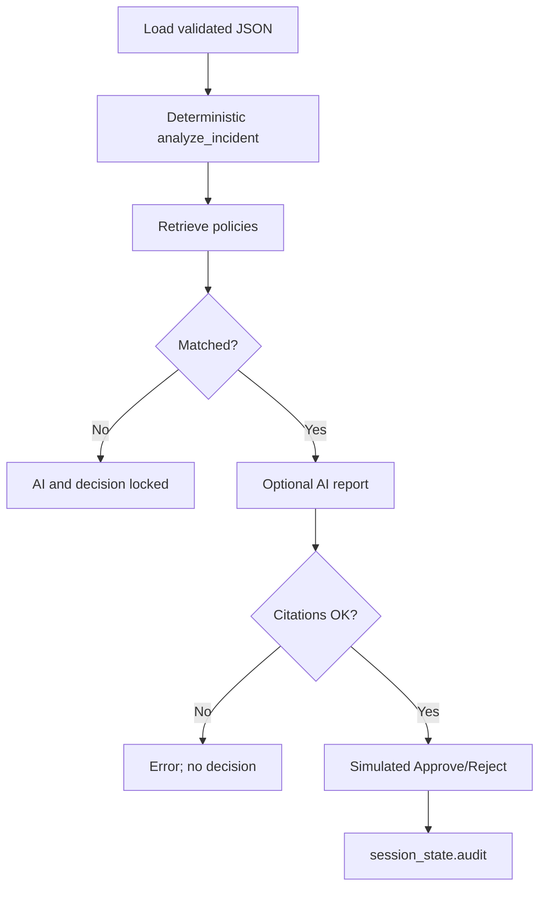

# MVP Workflow (MVP v2.2)

GuardBee provides three Streamlit pages via `st.Page` / `st.navigation` in `app.py`:

1. **Dashboard** — KPIs, classification overview, recent incidents.
2. **Security Incidents** — search/filter, deterministic investigation, policy retrieval, optional AI, simulated decision.
3. **Audit History** — session-scoped simulated decisions.

## End-to-end path

1. **Load** — `load_incidents` + `load_policies` (fail-closed).
2. **Analyze** — `analyze_incident` for each incident (cached in-memory for the run).
3. **Select** — analyst opens an incident; prior report/decision session fields clear on incident change.
4. **Retrieve** — `retrieve_policies` with query from title, department, flags, suggested action.
5. **Fingerprint** — `analysis_context_id(incident, analysis, matched_policies)`.
6. **Explain (optional)** — `generate_report` → `validate_report_citations`.
7. **Decide (optional)** — `can_record_decision` / `build_decision_record` → append `session_state.audit`.
8. **Review** — Audit History filters and detail for session records.

Canonical diagram files: [diagrams/workflow.mmd](diagrams/workflow.mmd), [diagrams/data_flow.mmd](diagrams/data_flow.mmd).

## Persistence clarification

- **Session state:** reports, active report id, decision lock, audit list used by the UI.
- **SQLite (`audit_store.py`):** available as a library with tests; **not** invoked by current `app.py`.
